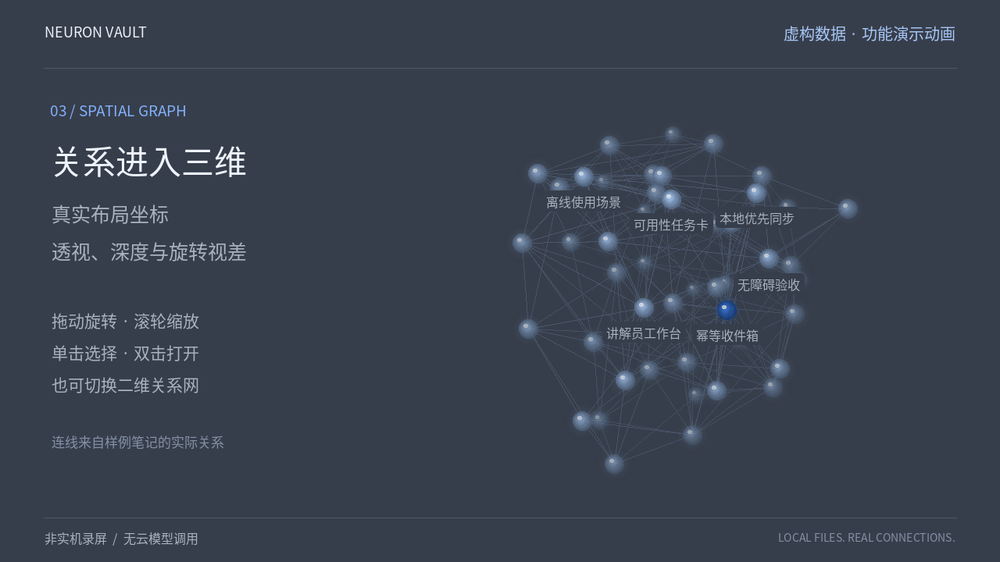

# Neuron Vault

**把笔记留在本机，把知识连接起来。**

Neuron Vault 是一个本地优先的个人 Markdown 知识库：写笔记、搜索原文、沿双链探索，再用带来源的问答查阅自己的资料。Java 后端管理普通文件，React 界面提供编辑器、二维关系网和可旋转的三维图谱。

*Local-first Markdown knowledge workspace with Chinese-friendly search, linked notes, interactive 3D/2D graphs, and source-linked retrieval. Optional model connections; no API key required to get started.*

[快速开始](#快速开始) · [使用指南](docs/user-guide.md) · [架构说明](docs/architecture.md) · [参与贡献](CONTRIBUTING.md)

[](docs/media/demo.mp4)

[观看功能演示动画（虚构数据，非实机录屏）](https://raw.githubusercontent.com/Mrytn/neuron-vault/main/docs/media/demo.mp4)。动画用于说明功能与交互，并非实际应用的屏幕录制。仓库中的演示笔记和测试数据均为虚构，不包含个人知识库内容。

## 能做什么

| 功能 | 实际行为 |
| --- | --- |
| Markdown 笔记 | 新建、编辑、移动、删除与回收站恢复；正文保存在普通 `.md` 文件中。 |
| 本地搜索 | 按标题和正文关键词检索，支持中文查询，显示命中片段及来源行。 |
| 双链与标签 | 解析 `[[笔记标题]]`、Markdown 笔记链接和标签；图谱只呈现实际关系。 |
| 三维图谱 | 透视投影、深度明暗、拖动旋转、缩放、节点选择；支持暂停自动旋转。 |
| 二维关系网 | 平移、缩放、拖动节点，查看选中节点的相邻关系。 |
| 带来源问答 | 未配置模型时返回本地检索摘录；配置模型后，可根据命中的有限片段生成带编号引用的回答。 |
| 文件迁移 | 导出活动笔记及附件为 ZIP；提供本地有道导出导入工具。 |

这不是语义向量数据库。当前没有嵌入检索、OCR、图片内容理解、多人账号权限、自动云同步或移动端原生应用。未配置模型时的“问答”是原文检索，不是模型推理；配置模型后，引用编号也不代表结论已被事实核查。

## 快速开始

需要 **JDK 17、Node.js 22、Maven 3.6.3+**；运行演示和导入工具还需要 **Python 3.10+**。脚本使用 Bash 和 POSIX 文件权限，建议在 Linux、macOS 或 WSL2 中运行；Windows 原生环境尚未验证。

```bash
git clone https://github.com/Mrytn/neuron-vault.git
cd neuron-vault
./scripts/build.sh
./scripts/start.sh
```

打开 **http://127.0.0.1:8787**。首次启动是空知识库，不需要注册账号或填写 API Key。服务在当前终端运行，按 `Ctrl+C` 停止。

构建会下载 npm 和 Maven 依赖，并执行后端测试。首次安装需要能访问相应软件源；应用的本地编辑、搜索和图谱不依赖云模型。

### 先用虚构笔记体验

完成构建后运行：

```bash
./scripts/demo.sh
```

打开 **http://127.0.0.1:8790**。演示使用 `demo/vault/` 中的虚构笔记，运行数据保存在独立的 `.demo-data/`，与日常使用的 `data/` 分开。再次启动用 `./scripts/demo.sh --reuse`，保留练习修改；默认不会覆盖已有副本。若设置过 `VAULT_HOME`，先使用 `env -u VAULT_HOME ./scripts/demo.sh`。

### 数据放在哪里

默认结构：

```text
data/
├── vault/                 # 活动笔记 Markdown 与 assets/ 附件
├── .metadata/index.json   # 稳定 ID、来源和回收状态
├── .trash/                # 可恢复的已删除笔记
└── .config/settings.json  # 可选模型配置及密钥
```

设置页显示实际 `vault/` 路径。可以直接用编辑器修改 Markdown，再在界面刷新；保存冲突会阻止旧草稿覆盖新文件。

自定义数据目录和端口：

```bash
VAULT_HOME="$PWD/my-vault-data" NEURON_PORT=8788 ./scripts/start.sh
```

`VAULT_HOME` 是上图的**数据根目录**，不是其中的 `vault/`。自定义目录也需要自行排除在版本控制之外。完整备份应在停止服务后复制整个数据根目录；ZIP 导出不包含模型密钥、回收站或应用元数据，不能替代完整备份。

### 可选：连接模型

在“工作空间设置”中选择接口类型，填写服务商提供的 Base URL、模型标识和你自己的 API Key。支持 OpenAI Responses API 与 Chat Completions 兼容接口；仓库不预置可用密钥或付费模型。

请求只携带当前问题、命中资料的标题、行号及最多 5 个限长片段，不发送整库或附件。服务商可能收费并按其政策处理这些内容。清空模型名称并保存可切回本地检索；空白密钥输入会保留已有密钥。更多细节见[使用指南](docs/user-guide.md#模型与来源)。

## 开发与验证

```bash
# 前端组件、状态与图谱测试
cd frontend
npm ci
npm test
npm run build
cd ..

# 后端测试与打包
mvn -B -ntp -f backend/pom.xml verify

# Python 导入工具测试：仅使用临时合成数据
python3 -m unittest discover -s scripts -p 'test_*.py' -v
```

CI 使用独立的前端、后端与 Python 任务，不需要模型凭据。Canvas 测试使用绘图记录器验证交互与投影；视觉观感仍应在实际浏览器中检查。

开发服务、导入步骤和故障排查见[使用指南](docs/user-guide.md)；模块职责与数据流见[架构说明](docs/architecture.md)。

## 本地使用边界

服务默认仅监听 `127.0.0.1`，并检查请求的 Host、Origin 和跨站来源。它没有多人认证，也不适合直接暴露到公网。同一台机器上的其他程序仍可能访问你的文件或本地服务。

密钥以本机配置文件保存，依靠文件权限保护，**不是加密保险箱**。笔记中的远程图片默认不自动加载；点击加载或打开外部链接时，浏览器会访问对应网站。

报告普通问题请使用 GitHub Issues；漏洞请按照 [SECURITY.md](SECURITY.md) 私下报告，不要公开真实笔记、密钥或个人导出文件。

维护者：**Mrytn** · 联系邮箱：[hankukedong@gmail.com](mailto:hankukedong@gmail.com)。

## 许可证

[MIT](LICENSE) © Mrytn。项目代码与演示内容可按许可证使用；导入的个人笔记及第三方内容仍适用其各自的权利和许可。
