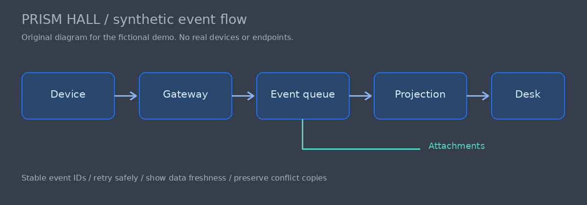

# 系统边界

虚构系统分为设备接入、事件处理、状态投影和讲解员工作台四个责任边界。

> **合成演示资料**：本文完全虚构，不含真实用户笔记、访谈、机构或业务数据。数字只用于说明格式与实验设计。

## 核心记录

- 设备接入只负责协议校验、消息标识和接收确认；复杂业务处理在后续队列完成。

- 状态投影面向查询优化，原始事件用于追溯；两者的更新时间不能混淆。

- 附件通过独立生命周期管理，图片失败不得撤销已经确认的业务事件。

## 如何核对

画出一次借出的正常链路和两条失败链路，确认每个失败都有可解释的状态。

## 关联笔记

[[事件信封]] · [[异步任务队列]] · [[读模型投影]] · [[附件生命周期]] · [[接口契约]]

## 原创示意图

设备经接入校验进入事件队列，由状态投影更新工作台；附件使用独立存储。[下载原创 SVG](../assets/demo/event-flow.svg)。图中不包含真实地址、配置或凭据。
